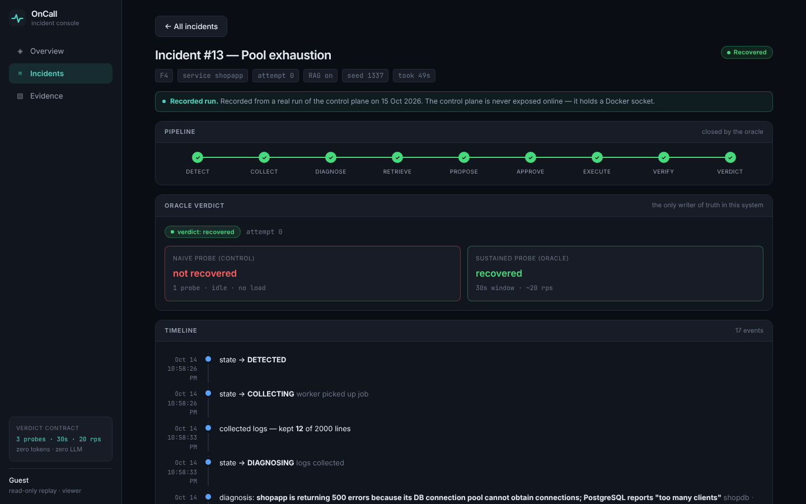
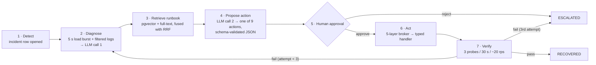
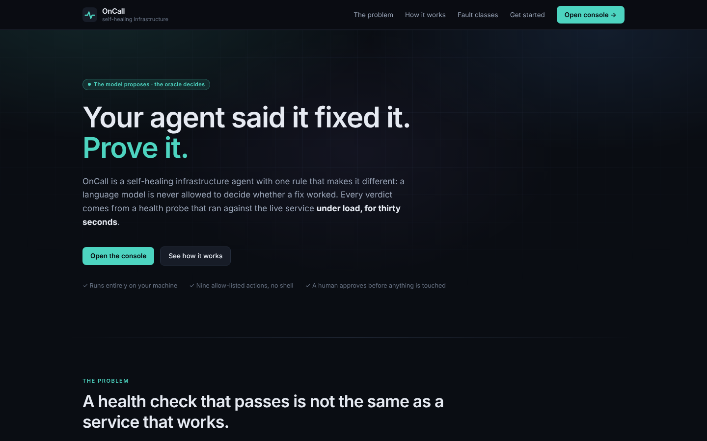
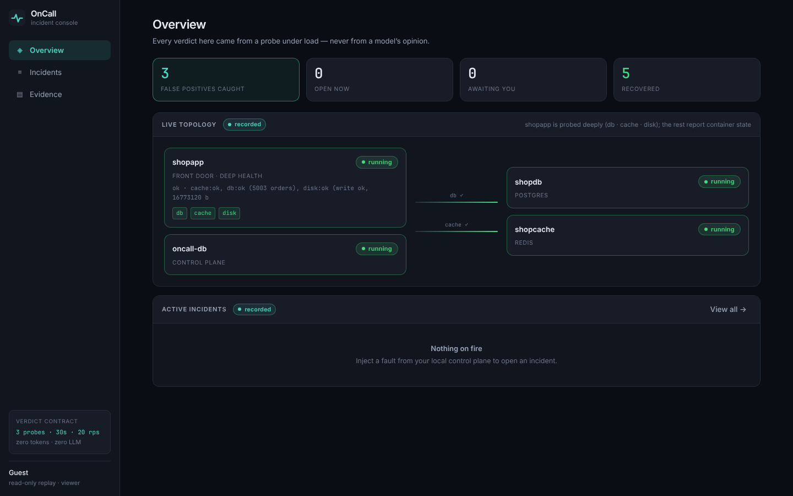
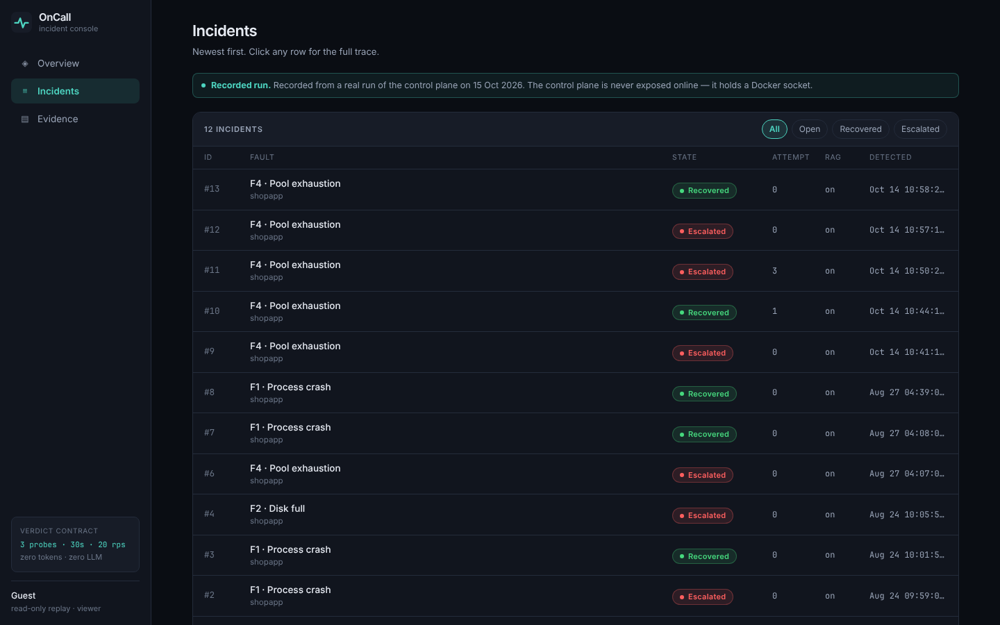
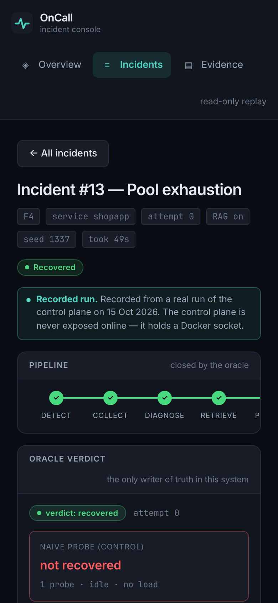
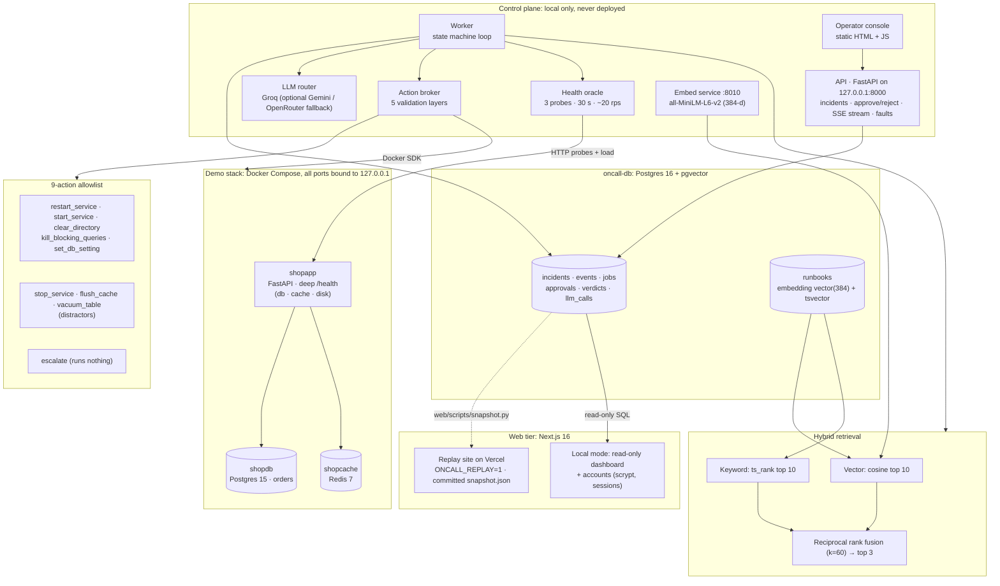
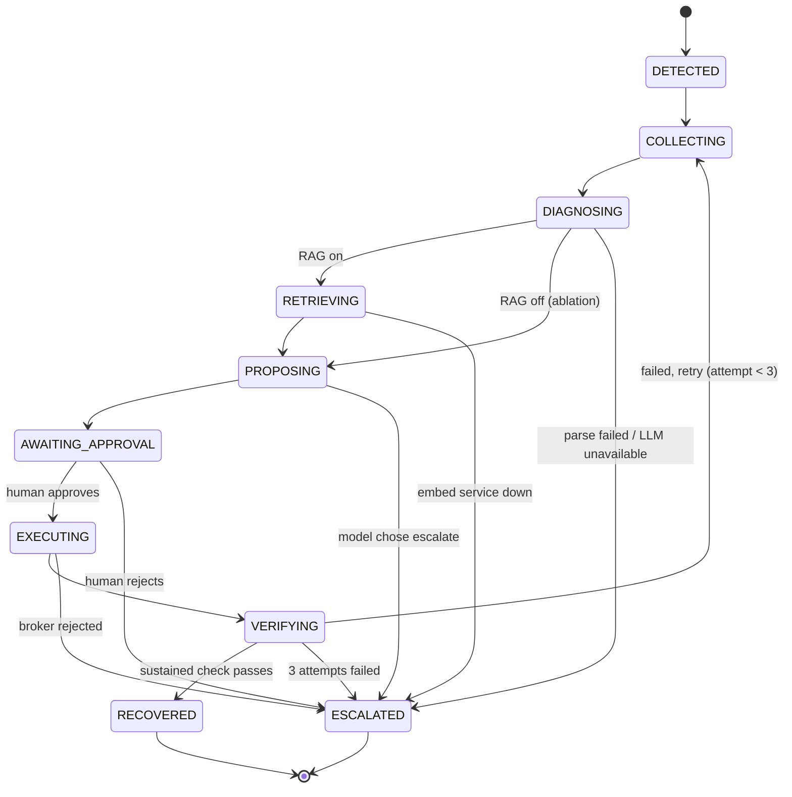
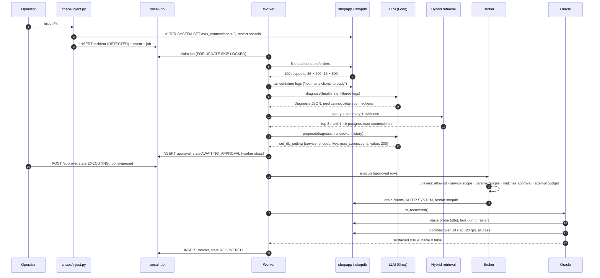

# OnCall

**An incident-response agent for a containerised service. It diagnoses a fault, retrieves a runbook and proposes one allow-listed fix. A human approves the fix before it runs, and a health check under load decides whether it worked. The language model never decides that.**

[](https://oncall-replay.vercel.app)


---

## Replay demo

**▶ https://oncall-replay.vercel.app** is a read-only replay of real incidents recorded on a local run (snapshot taken 15 Oct 2026). Every screen carries a "recorded" label, and sign-in is turned off. The control plane itself is never deployed. [Safety](#safety) explains why.



<sub>Incident #13 in the replay. The fault is F4 (connection-pool exhaustion). The agent proposed `set_db_setting max_connections=200`, a human approved it, and the sustained check passed. The one-shot "naive" probe right after the restart said *not recovered*. Both verdicts are stored.</sub>

---

## Contents

[Problem](#the-problem) · [Incident flow](#how-an-incident-flows) · [Screenshots](#screenshots) · [Architecture](#architecture) · [State machine](#incident-state-machine) · [Data model](#data-model) · [Faults](#the-five-injected-faults) · [Tech stack](#tech-stack) · [Getting started](#getting-started) · [Testing](#testing) · [Safety](#safety) · [Limitations](#limitations)

---

## The problem

An on-call engineer gets paged, opens a dashboard, reads logs, searches a wiki for the runbook, runs a command and watches a graph to see whether the fix held. Most of that time goes to gathering context and following a known procedure. Very little of it is judgement.

Handing the whole loop to an autonomous agent has two failure modes:

1. **The agent picks a harmful action.** A free-form shell in the hands of a language model is a production incident waiting to happen.
2. **The agent says "fixed" when it isn't.** If success means "the command exited 0", or one health probe returned 200, or a second model agreed it worked, a fault that only appears under load will look resolved.

OnCall splits the work. **The agent does the repetitive part**: it collects logs, writes a diagnosis, retrieves runbooks and proposes one action. **A human makes the risky call**: approve or reject. **An executed check settles the outcome**: three probes over 30 seconds while a load generator sends about 20 requests per second.

---

## How an incident flows



| Step | What happens in the code |
|---|---|
| **Detect** | Injecting a fault writes an `incidents` row in state `DETECTED`, its first `events` row and a queued `jobs` row in one transaction (`chaos/inject.py`). A worker claims the job with `FOR UPDATE SKIP LOCKED`. |
| **Diagnose** | The worker runs a 5-second load burst against `/orders` so load-only faults show up. It then pulls the last 2,000 container log lines and keeps the error lines, newest first. LLM call #1 returns a `Diagnosis` Pydantic object (`extra="forbid"`). |
| **Retrieve** | The diagnosis becomes a query. The top 10 hits from pgvector cosine search and the top 10 from Postgres full-text search (`ts_rank`) are fused with reciprocal rank fusion (k = 60). The top 3 are stored in `retrievals`. |
| **Propose** | LLM call #2 must return a `ProposedAction` whose `action` is a `Literal` of exactly 9 names. Invalid output escalates. If the model chooses `escalate`, nothing runs. |
| **Approve** | The proposal is a row in `approvals`. The worker stops, so no thread waits on a human. `POST /api/incidents/{id}/approve` records the decision and re-queues the job. |
| **Act** | The broker re-validates everything at 5 layers and then calls a typed handler through the Docker SDK. No shell is involved. |
| **Verify** | One idle "naive" probe, then 3 probes 10 s apart while about 20 rps hit the service. Only the sustained result can move the incident to `RECOVERED`. Both results go into `verdicts`. |

---

## Screenshots

All screenshots come from the replay build (`ONCALL_REPLAY=1`) and its committed snapshot. They were captured with Playwright.

| Landing page | Overview |
|---|---|
|  |  |

| Incident list | Mobile, 390 px |
|---|---|
|  |  |

---

## Architecture



**Design points visible in the code**

- **Two databases.** The agent's evidence lives in `oncall-db` (port 5433), separate from the `shopdb` it repairs. F3 and F4 break `shopdb`, so if the evidence lived there, the most important part of each incident would never get written.
- **Postgres is the job queue.** It uses `FOR UPDATE SKIP LOCKED` plus a stale-lock reaper. There is no separate broker. An in-flight incident survives a worker restart because its state is a row, not memory.
- **Two LLM calls per attempt**, and both outputs are schema-validated. Every call is logged to `llm_calls` with provider, model, tokens, latency and raw response.
- **The ground truth stays out of the agent's path.** The correct action for each fault lives only in `chaos/faults.py`. `make lint` checks with grep that the agent code never imports `chaos/` or reads ground-truth fields.

---

## Incident state machine

The ten states and their 16 allowed edges are stored as data in `oncall/agent/states.py`. They are guarded by `assert_transition()` and mirrored in a `CHECK` constraint in `stack/oncalldb/init.sql`. `tests/test_states.py` fails if those copies drift apart.



### One incident, end to end

This is recorded incident #13 (F4) from the replay snapshot. The values in the messages are the ones it recorded.



---

## Data model

These diagrams are drawn from `stack/oncalldb/init.sql` (control plane), `web/db/web_schema.sql` (web tier) and `stack/shopdb/init.sql` (demo app).

```mermaid
erDiagram
    incidents ||--o{ events : "timeline"
    incidents ||--o{ jobs : "queued work"
    incidents ||--o{ llm_calls : "per call"
    incidents ||--o{ approvals : "one per attempt"
    incidents ||--o{ verdicts : "one per attempt"
    incidents ||--o{ retrievals : "top-k per attempt"
    runbooks ||--o{ retrievals : "runbook_id (logical, no FK)"
    web_users ||--o{ web_sessions : "has"

    incidents {
        bigserial id PK
        text service
        text fault_class
        text state "CHECK: 10 states"
        int attempt "0..3"
        timestamptz detected_at
        timestamptz closed_at "set iff terminal"
        bool rag_enabled
        int seed
    }
    events {
        bigserial id PK
        bigint incident_id FK
        timestamptz at
        text kind "CHECK: 10 kinds"
        jsonb payload
    }
    jobs {
        bigserial id PK
        bigint incident_id FK
        text status "queued|running|done|failed"
        timestamptz locked_at
        text locked_by
        int attempts
        text last_error
    }
    llm_calls {
        bigserial id PK
        bigint incident_id FK
        text call_site "diagnose|propose"
        text provider
        text model
        int prompt_tokens
        int completion_tokens
        int latency_ms
        bool ok
        text raw_response
    }
    approvals {
        bigserial id PK
        bigint incident_id FK
        int attempt "UNIQUE with incident_id"
        text action
        jsonb params
        text rationale
        text decision "approved|rejected|NULL"
        timestamptz decided_at
    }
    verdicts {
        bigserial id PK
        bigint incident_id FK
        int attempt "UNIQUE with incident_id"
        bool sustained_recovered
        bool naive_recovered
        jsonb probes
        int load_rps
        int window_s
    }
    retrievals {
        bigserial id PK
        bigint incident_id FK
        int attempt
        text runbook_id
        int rank "1..10"
        real rrf_score
        int vector_rank
        int keyword_rank
    }
    runbooks {
        text id PK
        text title
        text body
        text source
        text source_url
        text licence
        date fetched_at
        vector embedding "384-d"
        tsvector tsv "generated, GIN index"
    }
    web_users {
        bigserial id PK
        text email UK
        text display_name
        text password_hash "scrypt"
        text role "viewer|operator"
    }
    web_sessions {
        bytea token_hash PK
        bigint user_id FK
        timestamptz expires_at
    }
```



| Table | Purpose |
|---|---|
| `incidents` | One row per fault, from `DETECTED` to a terminal state. Holds `fault_class` for scoring but **not** the correct action, so the agent cannot read the answer. A `CHECK` requires `closed_at` to be set exactly when the state is terminal. |
| `events` | Append-only timeline: state changes, logs, diagnosis, retrieval, proposal, approval, execution, verification and escalation. The SSE stream and the UI read from it. |
| `jobs` | The work queue. A partial unique index allows at most one queued or running job per incident. |
| `llm_calls` | Every model call, with provider, model, token counts, latency, the raw response and any error. |
| `approvals` | The human gate. One row per (incident, attempt). Before running anything, the broker checks that the action and params match the approved row exactly. |
| `verdicts` | Both oracle results for every attempt, plus the raw probes, so you can count where the naive and sustained checks disagree. |
| `retrievals` | The fused top-k for each attempt, with the vector rank and keyword rank kept separately for analysis. |
| `runbooks` | The corpus. Each row records its source URL, licence and fetch date. Holds a 384-d embedding and a generated `tsvector` with a GIN index. |
| `web_users` / `web_sessions` | Web-tier accounts for local mode. Sessions store only a hash of the token. Accounts are turned off on the public replay. |
| `orders` (shopdb) | The demo app's data. F3 locks this table. |

---

## The five injected faults

The faults are defined in `chaos/faults.py`. Every fault shows up first on **shopapp's** `/health`, even when the real culprit is another container. The incident row always says `service = shopapp`, so the agent has to work out the target itself.

| ID | What the injector does | What breaks | How it shows up | Correct action | Does a restart alone fix it? |
|---|---|---|---|---|---|
| **F1** | `SIGKILL` shopapp | The process is gone | `/health` refuses connections; container `exited (137)` | `restart_service shopapp` | **Yes.** This is the positive control. |
| **F2** | `dd` writes 64 MB into a 16 MiB tmpfs cache dir | Writes fail | `/health` 503, disk check `Errno 28 No space left on device` | `clear_directory` | No. A new process writes to the same full disk. |
| **F3** | Holds an `ACCESS EXCLUSIVE` lock on `orders` for 600 s | DB reads block | `/health` DB check times out, then 503 | `kill_blocking_queries shopdb` | No. The lock belongs to another DB session. |
| **F4** | `ALTER SYSTEM SET max_connections = 5`, restart shopdb | The pool runs out under load | **Idle `/health` is 200.** Under load: `FATAL: sorry, too many clients already`. Found by the 5 s load burst before diagnosis. | `set_db_setting max_connections` on shopdb | No. The setting persists in `postgresql.auto.conf`, and the restart only empties the pool. |
| **F5** | Stops shopcache | Redis dependency is down | `/health` 503, cache check fails, though shopapp itself is healthy | `start_service shopcache` | No. The red service is not the broken one. |

F4 is the reason for the sustained oracle. A single probe after a restart can pass while the service still fails under real traffic.

---

## Tech stack

| Part | Tool | Why |
|---|---|---|
| Control-plane API | **FastAPI** + uvicorn | Async endpoints for the approve and reject routes, and Server-Sent Events for live timelines. |
| Live updates | **SSE** (`text/event-stream`) | Updates flow one way only. The browser's `EventSource` reconnects on its own and resumes from the last event id. |
| Agent state and queue | **PostgreSQL 16** (`pgvector/pgvector:pg16`) | One database handles state, the timeline, the queue (`FOR UPDATE SKIP LOCKED`) and vector search, so there are fewer moving parts. |
| Vector search | **pgvector**, cosine distance, 384-d | Runs inside the database that already exists. |
| Keyword search | Postgres **`tsvector` / `ts_rank`** with a GIN index | Catches exact error strings (`too many clients`) that embeddings can blur. |
| Fusion | **Reciprocal rank fusion** (k = 60) | Merges two ranked lists without tuning scores across different scales. |
| Embeddings | **sentence-transformers `all-MiniLM-L6-v2`**, as a local HTTP service | Free and runs on CPU. A separate process keeps torch out of the API and the worker. |
| Language model | **Groq** (`openai/gpt-oss-120b` by default). Gemini and OpenRouter are wired in as a fallback chain when `ONCALL_PIN_PROVIDER` is empty. | Free tier, JSON mode. Every call goes through one router that logs it. |
| Output validation | **Pydantic v2** (`extra="forbid"`, `Literal` action names) | The model cannot invent an action or an extra field. |
| Container control | **Docker SDK for Python** | Typed API calls. No `subprocess` and no shell. |
| Health oracle | **httpx** (async) | Concurrent probes and a 20 rps load generator in one event loop. |
| Demo app | FastAPI + **psycopg-pool** + **Redis 7** + **Postgres 15** | A small service with real dependencies, so each fault has a real failure mode. |
| Operator console | Plain **HTML + vanilla JS** (`static/`) | No build step for the local tool that holds the dangerous buttons. |
| Web tier and replay | **Next.js 16**, React 19, Tailwind CSS 4, TypeScript, `pg` | A read-only dashboard, plus the public replay hosted on **Vercel**. |
| Web auth (local mode) | Node `crypto.scrypt`, hashed session tokens, rate limiting | scrypt is memory-hard and part of Node's standard library, so no native module is needed. |
| Tests | **pytest**, pytest-asyncio | Plain functions. Tests that need the live stack skip themselves. |

---

## Getting started

### Prerequisites

Docker with Compose v2, Python 3.11 and Node 20+. You need a Groq API key for the two LLM calls.

```bash
git clone https://github.com/zakuroooo/oncall.git
cd oncall
cp .env.example .env            # add your GROQ_API_KEY; never commit .env
```

### 1. Python environment

```bash
make install                    # creates .venv (Python 3.11) and installs requirements.txt
```

> The Makefile defaults to Homebrew's `python3.11`. On Linux, pass your own interpreter: `make install PY=python3.11`.

### 2. Run the stack and the control plane (needs Docker)

```bash
make up              # shopapp, shopdb, shopcache, oncall-db (ports bound to 127.0.0.1)
make migrate         # read-only schema check
make install-ingest  # embedding deps (large: pulls torch)
python scripts/ingest_runbooks.py           # dry run: shows what would be stored
python scripts/ingest_runbooks.py --write   # fetch, chunk and embed the runbook corpus
make serve           # API :8000 + worker + embed service :8010 (logs in /tmp/oncall-*.log)
```

Open **http://127.0.0.1:8000**, inject a fault (start with **F1**, then try **F4**), and approve the proposal when the incident reaches `AWAITING_APPROVAL`. Reset between runs with `make heal-all`. Stop with `make stop` (processes) and `make down` (containers).

### 3. Run the replay site locally (no Docker needed)

```bash
cd web
npm ci
ONCALL_REPLAY=1 npm run build
ONCALL_REPLAY=1 npm run start   # http://localhost:3000
```

### 4. Run the tests

```bash
make test        # = .venv/bin/python -m pytest
make lint        # 6 grep-enforced security invariants (no shell, no LLM-as-judge, ...)
```

> ⚠️ **Never run pytest while a live incident is in progress.** Some tests inject and heal faults on the real stack, and a heal in the middle of an incident changes its verdict. This has happened: in the replay, attempt 2 of incident #10 is marked invalid for this reason.

**Which steps were checked for this README:** I ran `make install` (with `PY=python3.11`), `make test`, `make lint` and the replay build and start (`ONCALL_REPLAY=1`) on Linux. I could not run the Docker steps in that environment. They are taken from the Makefile and `docker-compose.yml`.

---

## Testing

**157 passed, 9 skipped** with `python -m pytest`, Python 3.11, without the Docker stack. The skipped tests need live services:

- `tests/test_oracle.py`: the falsifier pair `test_naive_says_true_on_f4_restart` / `test_sustained_says_false_on_f4_restart` (skipped as a module).
- 6 tests in `tests/test_metrics.py` that query `oncall-db`.
- 2 tests in `tests/test_sparse_retrieval.py` that need the runbook corpus.

| File | What it covers |
|---|---|
| `test_broker.py` | Adversarial checks on the 5 validation layers: unknown or mis-cased actions, the agent touching its own database, prefix tricks on paths, `bool` passed as `int`, out-of-range values, actions or params swapped after approval, attempt budget |
| `test_inject.py` | Dry runs never touch the DB, the incident row never reveals the target service, and listings leak no answers |
| `test_seed.py` | The deterministic synthetic order seeder |
| `test_pure_logic.py` | RRF fusion, Wilson intervals, JSON extraction from model output, the log filter, the prompt-injection heuristic and the load-burst description |
| `test_states.py` | Exactly 16 allowed edges, no way around the approval gate, no route from a retry back to `PROPOSING`, and agreement with the SQL `CHECK` |
| `test_queries.py`, `test_schema.py` | SQL lives only in named constants, DDL is idempotent, no `SELECT *`, and runbook queries never expose ground truth |
| `test_metrics.py` | Per-class metrics with no aggregate row; naive-versus-sustained disagreement is counted in one direction only |
| `test_no_shell.py` | No shell calls and no LLM-as-judge in `oncall/`, and `oncall/` never imports `chaos/`. Includes planted violations to show the guard catches them. |
| `test_frontend_contract.py` | API shapes the UI depends on |

### Four bugs found on live runs, and how each was fixed

These were found by running F4 incidents against the real stack, not by reading code, and were fixed in commit [`a156167`](https://github.com/zakuroooo/oncall/commit/a1561679fe83a8f0f423decb69ad725735a9dfb4) with regression tests.

| # | Bug | Root cause | Fix |
|---|---|---|---|
| 1 | Keyword retrieval returned **0 candidates on every incident** | `plainto_tsquery` ANDs every stem of a multi-sentence diagnosis, so no runbook matched all of them | Terms are OR-ed and ranked by `ts_rank` (`oncall/retrieval/search.py`). Tests in `tests/test_sparse_retrieval.py`. |
| 2 | Load-only faults (F4) were **invisible to diagnosis** | An idle `/health` returns 200, so the model saw a healthy service | A 5 s load burst runs before log collection, and its result is passed to the model with the health line (`agent/loop.py`, `agent/diagnose.py`) |
| 3 | The log filter **kept noise and dropped the signal** | Traceback frames matched on file paths such as `errors.py`, and the *oldest* 12 lines were kept | Level words are matched anywhere, exception summary lines are kept, and the newest lines come first from a 2,000-line tail (`agent/collect.py`) |
| 4 | `set_db_setting` **could not connect while the pool was exhausted**, so the F4 fix itself failed | The handler needed a DB connection that F4 had taken | Drain the database's clients, apply the setting, restart, then bring the clients back (`actions/handlers.py`) |

---

## Safety

**The control plane is never deployed.** It is a local tool:

- **It holds the Docker socket**, which is root-equivalent on the host. Anyone who can reach it can start a container that mounts `/`.
- **It has no authentication.** Anyone who can reach `127.0.0.1:8000` can approve a remediation or call `POST /api/faults/{id}/inject`, which breaks things on purpose.
- The listen address is **hardcoded** to `127.0.0.1` in `oncall/config.py` and deliberately cannot be set by an environment variable. Every port in `docker-compose.yml` is bound to `127.0.0.1`.
- The public site is a **replay**: a Next.js build over a committed JSON snapshot. It has no connection to Docker or the control plane, and sign-in is turned off.

**The action allowlist.** The model chooses one of 9 actions (`oncall/actions/allowlist.py`). Five are corrective, three are plausible distractors that fix nothing, and `escalate` runs nothing. Before any handler runs, the broker checks 5 layers:

1. The action is in the allowlist (also enforced by a Pydantic `Literal`).
2. The service is in scope: `shopapp`, `shopdb` or `shopcache`, and DB-only actions accept only `shopdb`.
3. The params are exactly the required set. Paths come from a 2-entry allowlist, DB keys from a 3-entry allowlist with integer ranges, and tables from a 1-entry allowlist.
4. There is an `approved` row, and the action and params match it exactly.
5. The attempt is within the budget (fewer than 3).

No command string is built from model output and no shell is spawned. `make lint` checks this with grep. There is one documented exception: `ALTER SYSTEM SET` does not accept bind parameters, so that one statement interpolates a key from the 3-item allowlist and a range-checked integer.

**Human approval.** Every action waits in `AWAITING_APPROVAL` until a person clicks approve or reject. A rejection closes the incident as `ESCALATED` with the reason recorded. No code path goes from `PROPOSING` to `EXECUTING` without passing through `AWAITING_APPROVAL`.

---

## Limitations

- **No success rate is claimed.** The recorded runs are a handful of incidents, all from one machine, which is far too few to measure how often the agent picks the right fix. The replay snapshot holds 12 incidents covering only **F1, F2 and F4**. F3 and F5 are implemented but none is in the recording. The UI deliberately has no aggregate rate.
- **Detection is not a real monitor.** The fault injector opens the incident when it breaks something. No background process watches `/health` and pages on its own.
- **The demo world is small.** There are three containers, five fault classes and nine actions, on one Docker host. Real incidents are messier and often have no allow-listed fix. The agent can escalate, and in recorded runs it sometimes did.
- **The oracle's numbers are chosen, not derived.** 3 probes, 30 s and 20 rps are stricter than a single probe, but they are not tuned or proven sufficient.
- **It depends on an external LLM.** Diagnosis and proposal need a Groq key (or a fallback provider). Without one, incidents escalate with `llm_unavailable`.
- **Retrieval quality depends on the corpus**, which is fetched from public vendor docs. Each record carries its licence.
- **Not production software.** The control plane has no auth or multi-tenancy, and the Makefile assumes a macOS Homebrew Python unless you override `PY`.
- **No CI and no license file yet.** Tests run locally only, and there is no `LICENSE` in the repo.
